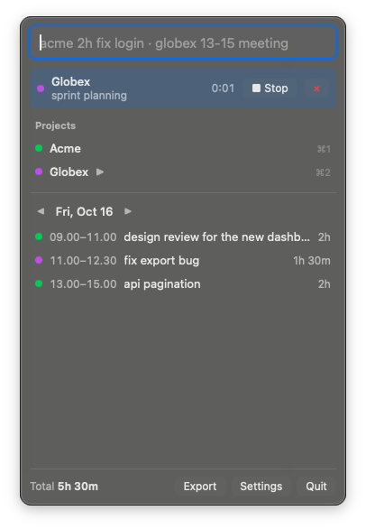

# Kala

A fast menu bar timesheet for macOS. Type one line, get a timesheet entry. Export a month to Excel in one click. Ask your AI how many hours you worked, through MCP.

Everything stays on your Mac: one SQLite file, no account, no server, no telemetry.

<p align="center"></p>

## Install

1. Download `Kala_x.y.z_universal.dmg` from [Releases](../../releases).
2. Drag Kala to Applications.
3. Builds are not signed yet. The first time, right-click Kala.app and choose **Open**, or run:

```bash
xattr -dr com.apple.quarantine /Applications/Kala.app
```

On first launch Kala opens Settings and asks you to record a global shortcut.

## Quick entry

Press your shortcut (or click the menu bar icon) and type:

```
[date] <project> [time] <description>
```

| You type | You get |
|---|---|
| `acme 2h fix login` | Acme, today, 2 hours ending now |
| `globex 13-15 sprint meeting` | Globex, today 13:00–15:00 |
| `yesterday acme 1.5h review` | Acme, yesterday, 1.5 hours after your last entry that day |
| `mon globex 30m standup` | Globex, last Monday |
| `16/10 acme 9-11.30 deploy` | Acme, 16 October, 09:00–11:30 |
| `acme refactor auth` | starts a timer for Acme |

- Durations: `2h`, `2j`, `1.5h`, `1,5j`, `30m`, `1h30m`.
- Ranges: `13-15`, `13.30-15`, `13:30-15:00`.
- Dates: `yesterday`/`kemarin`, weekday names in English or Indonesian, `16/10`, `2026-10-16`.
- Project names match by prefix or alias (`ac` → Acme).

Times Kala fills in for you (durations, stopped timers) follow the project's rounding: start rounds down, length rounds to the nearest unit. Ranges you type are kept as typed.

## Timer

Click a project in the popover, or press `⌘1`–`⌘9` while it is open. Starting another project stops the running one. The running timer shows in the menu bar.

## Export

Popover → **Export** → pick project and month. Kala writes `Kala-<Project>-YYYY-MM.xlsx` (or `.csv`) to Downloads: title, period, one row per entry, hours as decimals, price from the project's hourly rate, totals.

## MCP

Kala ships an MCP server in the same binary. Settings → MCP shows the exact command for your install. For Claude Code:

```bash
claude mcp add --scope user kala -- /Applications/Kala.app/Contents/MacOS/kala mcp
```

Tools: `log_time`, `list_entries`, `update_entry`, `delete_entry`, `summary`, `export`, `timer_start`, `timer_stop`, `timer_status`.

Then ask things like "log 2 hours on Acme for the login fix" or "how many Acme hours this month?".

## Build from source

Requires Rust (stable) and Node 22+.

```bash
npm install
npm run tauri dev
```

```bash
cargo test --workspace
npm run check
```

`KALA_DB=/path/to/test.db` points Kala at another database, handy while developing.

Project layout: `core/` is plain Rust (parser, rounding, SQLite store, export) with unit tests. `src-tauri/` is the menu bar shell and the `kala mcp` server. `src/` is a small Svelte UI.

## License

MIT
